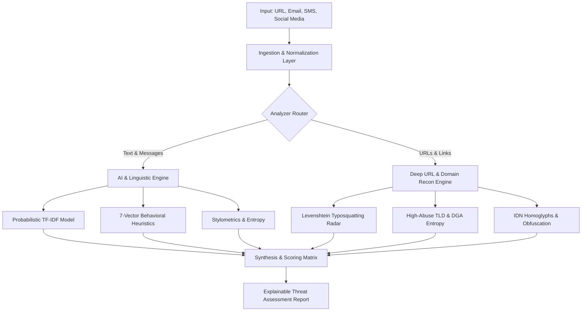

# 🛡️ ThreatLens AI — Phishing, Scam Message & Malicious URL Detection

[](https://github.com/threatlens/threatlens/actions)
[](https://www.python.org/)
[](https://opensource.org/licenses/MIT)
[](#privacy-first-architecture)

> **ThreatLens** is an advanced AI-powered cyber threat intelligence platform that identifies malicious emails, SMS (smishing), social media scams, and deceptive URLs associated with phishing, credential harvesting, and financial fraud.

---

## 📌 Problem Statement & Solution

Modern online deception has evolved beyond simple spelling mistakes. Attackers employ targeted brand impersonation, deceptive homoglyphs, automated Domain Generation Algorithms (DGAs), and high-pressure psychological triggers (fear, scarcity, urgency) across email, SMS, and direct messages.

**ThreatLens** solves this by combining:
1. **Probabilistic Machine Learning (ML)** for automated text classification and explainable feature extraction.
2. **7-Vector Linguistic Behavioral Threat Modeling** (Urgency, Sensitive Credential Theft, Financial Coercion, Prize Lures, Authority Spoofing, Blackmail/Extortion, and Stylometric Shouting).
3. **Deep Lexical & Domain Intelligence Reconnaissance** (Typosquatting distance against 60+ top targets, High-abuse TLD analysis, DGA Shannon entropy, Punycode IDNs, and IP evasion).

---

## 🚀 Key Capabilities

- **🧠 Probabilistic ML Classifier**: Evaluates unigram/bigram TF-IDF log-odds against pre-calibrated phishing corpora to produce calibrated probability scores ($0.0 - 1.0$) and extract the most influential predictive tokens (Explainable AI / XAI).
- **⚡ 7-Vector Linguistic Behavioral Analysis**:
  - **Urgency & Coercion**: Time pressure, account suspension threats, 24h ultimatums.
  - **Credential Harvesting**: Infiltration triggers seeking passwords, OTPs, 2FA/MFA, PINs, SSNs, and crypto seed phrases.
  - **Financial Pressure**: Unpaid toll notices, cryptocurrency demands, gift card requests, wire transfers.
  - **Lures & Greed**: Fake lotteries, prize notifications, high-yield investment/crypto doubling pitches.
  - **Authority Impersonation**: Spoofing Microsoft, Apple, Google, PayPal, Chase, USPS, FedEx, IRS, etc.
  - **Extortion & Fear**: Webcam recording claims, spyware/Pegasus extortion, arrest warrants.
  - **Stylometric Anomalies**: Excessive capitalization (SHOUTING ratio), repetitive punctuation bursts (`!!!`, `???`), and text entropy.
- **🌐 Deep URL & Domain Reconnaissance**:
  - **Brand Typosquatting & Visual Substitution**: Levenshtein distance and homoglyph substitution detection (e.g. `rnicrosoft.com`, `paypa1-security.com`, `goog1e.xyz`).
  - **High-Abuse TLD Surveillance**: Flags elevated-risk top-level domains (`.xyz`, `.top`, `.buzz`, `.work`, `.click`, `.fit`, `.icu`, etc.).
  - **DGA Shannon Entropy**: Measures host randomness to unmask algorithmically generated botnet domains.
  - **Homoglyph & IDN Protection**: Detects Cyrillic and Greek look-alike characters used to counterfeit Latin domains.
  - **Obfuscation Tricks**: Flags embedded user-info (`@` trick), multiple protocol markers, shorteners, and raw IP hostnames.
- **✉️ Modality-Specific Threat Scanners**:
  - **Email**: Dissects RFC headers (`From:`, `Reply-To:`), detects domain mismatches, generic greetings, and dangerous attachment extensions.
  - **SMS / Smishing**: Catches fake toll invoices (SunPass, EZ-Pass), postal redelivery lures (USPS, FedEx), and bank card lock alerts.
  - **Social Media**: Detects crypto doubling giveaways, Telegram/WhatsApp external pivot lures, and fake account recovery offers.
  - **Batch Screening**: High-throughput triage supporting up to 20 URLs/messages simultaneously for SOC teams.

---

## 🏛️ System Architecture



---

## 🛠️ Quick Start

### 1. Local Python Setup

```powershell
# Clone the repository
git clone https://github.com/threatlens/threatlens.git
cd threatlens

# Create and activate virtual environment
python -m venv .venv
.\.venv\Scripts\Activate.ps1    # On Linux/macOS: source .venv/bin/activate

# Install dependencies
python -m pip install -r requirements.txt

# Start the application
python app.py
```

Open your browser at **`http://127.0.0.1:5000`**.

### 2. Docker Deployment

```bash
docker compose up -d
```

The application will be running on port `5000`.

---

## 🧪 Running the Test Suite

ThreatLens features a comprehensive unit test suite covering dynamic ML training, linguistic pattern detection, brand typosquatting, email spoofing, and API endpoints:

```powershell
python -m unittest discover -s tests -v
```

All 26 unit tests run offline in milliseconds with zero external API dependencies.

---

## 📡 REST API Documentation

### 1. Unified Scan Endpoint
`POST /api/scan`

**Request Payload:**
```json
{
  "type": "email",
  "input": "From: service@paypal-security.xyz\nReply-To: bad@scam.top\nSubject: Urgent: Account Suspended\n\nVerify now: http://paypal.com.verify-login.xyz"
}
```

### 2. Batch Scan Endpoint
`POST /api/batch`

Accepts an array of up to 20 URLs or messages for rapid SOC screening.

### 3. Dynamic Threat Intelligence Status
`GET /api/threat-intel`

Returns active vector counts, targeted brand counts, high-abuse TLD counts, and ML vocabulary size.

### 4. Hot-Reload Threat Feeds
`POST /api/threat-intel/reload`

Instantly reloads threat intelligence rules, brand catalogs, TLD tables, and channel lures from `data/threat_intelligence.json` at runtime without server restarts.

### 5. Runtime ML Model Retraining
`POST /api/retrain`

Dynamically retrains the probabilistic classifier with an array of labeled samples (`[{"text": "...", "label": 1}]`), immediately updating TF-IDF vocabulary weights and prior log-odds.

### 6. Dynamic Samples Endpoint
`GET /api/samples`

Returns dynamic attack vectors and safe baselines loaded from `data/samples.json`.

### 7. Health Check
`GET /api/health`

Returns service health, engine capability status, and live threat counts.

---

## 🔒 Privacy-First Architecture

ThreatLens is designed to protect user confidentiality:
- Scans are executed locally on the application server.
- No text or URLs are forwarded to third-party ad networks or public cloud LLMs.
- Browser scan history is stored strictly in the client's local browser storage (`localStorage`) and can be cleared at any time with a single click.

---

## 📄 License

This project is licensed under the MIT License — see the [LICENSE](LICENSE) file for details.
